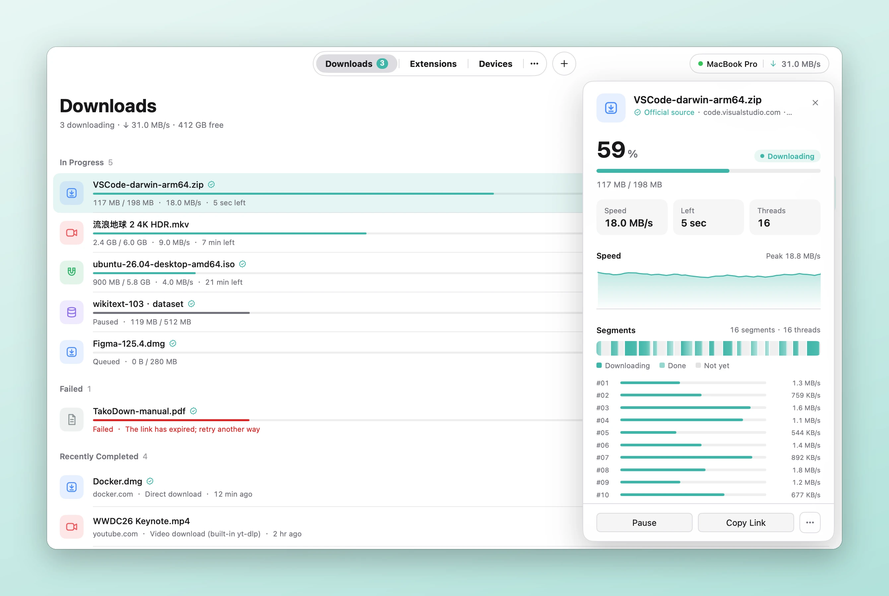

<div align="center">


# TakoDown

**Download anything. Eight arms at once.**

A fast, cross-platform desktop downloader for files, torrents, magnet links, video sites and streams — with a browser extension, a command line and AI agent tools.

[Website](https://takodown.com) · [Download](https://github.com/1TeamTop/takodown/releases/latest) · [Chrome extension](https://chromewebstore.google.com/detail/takodown/lpaplddpgaaefejdlbbniiakgmblmain) · [Firefox add-on](https://addons.mozilla.org/firefox/addon/takodown/)

[](https://github.com/1TeamTop/takodown/releases/latest)
[](https://github.com/1TeamTop/takodown/releases)


</div>

<picture>
  <source media="(prefers-color-scheme: dark)" srcset="assets/screenshots/hero-dark.webp">
  
</picture>

## Features

- **Multi-threaded downloads** — large files download in parallel segments, resume after an interruption, and retry by themselves.
- **One app for every kind of link** — HTTP/HTTPS, BitTorrent and magnet links, video sites, HLS/DASH streams, and FTP/SFTP.
- **Video downloads** — the built-in yt-dlp handles YouTube, Bilibili and more than a thousand other sites: choose the quality, add subtitles, or keep only the audio as MP3.
- **Link extraction** — paste text from a chat or a web page and get its links, grouped and deduplicated; ranges such as `img[1-3].jpg` expand by themselves.
- **Menu bar panel** — speed and progress at a glance, without opening the main window.
- **Speed limits and scheduling** — limit a single task or certain hours of the day, start tasks at a set time, and choose a proxy per site.
- **Browser extension** — takes over downloads in Chrome, Edge, Firefox, Brave, Arc and others, passing cookies along so files behind a sign-in download too.
- **Command line and AI tools** — the `tako` command, and an MCP server and Skills for Claude Code, Codex, Cursor, Gemini CLI, GitHub Copilot and OpenCode.
- **Light and dark**, in English and Chinese.

## Download

Get the latest version from the [**Releases**](https://github.com/1TeamTop/takodown/releases/latest) page, or from the [website](https://takodown.com). Both have the same installers.

| Platform | File |
| --- | --- |
| macOS — Apple silicon | `TakoDown-<version>-arm64.dmg` |
| macOS — Intel | `TakoDown-<version>-amd64.dmg` |
| Windows — x64 / Arm64 | `TakoDown-Setup-<version>-amd64.exe` / `-arm64.exe` |
| Linux — x64 / Arm64 | `takodown_<version>_amd64.deb` / `_arm64.deb`, or the portable `.tar.gz` |

The macOS app is signed and notarized by Apple. Each release lists the SHA-256 checksums of its files in `SHA256SUMS.txt`. Once installed, TakoDown keeps itself up to date.

On Linux you can also install it with one command:

```sh
(curl -fsSL https://dl.takodown.com/updates/install.sh || wget -qO- https://dl.takodown.com/updates/install.sh) | sh
```

## Browser extension

Install it from the [Chrome Web Store](https://chromewebstore.google.com/detail/takodown/lpaplddpgaaefejdlbbniiakgmblmain) (also for Edge, Brave, Arc, Vivaldi and other Chromium browsers) or [Firefox Add-ons](https://addons.mozilla.org/firefox/addon/takodown/). It works together with the desktop app:

- Downloads in the browser go to TakoDown; choose which file types and sizes it takes over, and Alt-click to keep one in the browser.
- Right-click a link to download it with TakoDown, or a video page to download the video.
- Cookies go along with each download, so files that need a sign-in work.

## Command line and AI tools

TakoDown comes with the `tako` command (Settings → Command Line → Install). AI agents can use TakoDown through MCP or a Skill, installed with one click in Settings → AI Tools, or from the command line:

```sh
tako add "https://example.com/file.zip" --wait   # add a download and wait for it
tako ls                                         # list the tasks
tako mcp install --client claude-code           # let Claude Code use TakoDown through MCP
tako skill install --agent codex                # install the Skill for Codex
```
